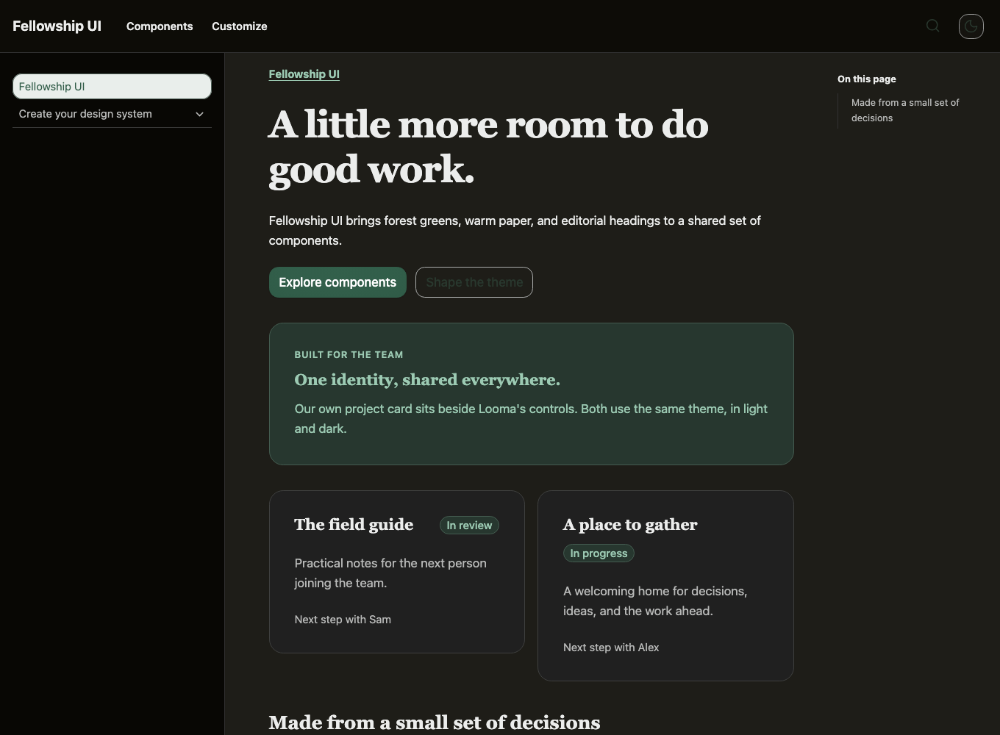

# Theme your system

Open **Customize** in your local docs site. You can try a starting theme, refine its shared decisions, and see the result on real components.

## Choose a starting point

Pick a starting theme in the summary bar. Each choice sets a coordinated identity across color, typography, shape, spacing, material, and motion.

- **Minimal** keeps neutral colors and restrained depth.
- **Gold** combines warm actions with rounded, polished surfaces.
- **Bookish** pairs wine and coral accents with reading-focused type.
- **Editorial** uses flat ink-and-paper surfaces and serif headings.
- **Night** uses cool accents and glass material.
- **Garden** brings forest, clay, and gold together with soft corners.

## Refine one family at a time

Open a summary on the overview to edit that subject. Choose **Overview** to return.

::: table

- Editor: Palette
  Try: Change your brand seeds, then compare light and dark specimens.

- Editor: Typography
  Try: Choose a body font and a heading font. Check a heading beside a form label.

- Editor: Size & spacing
  Try: Adjust control roominess and spacing while comparing the size ladder.

- Editor: Material & light
  Try: Move the light source and compare matte and polished surfaces.

- Editor: Motion
  Try: Replay the motion study and open the example popover.

:::

Edits apply immediately. Use **Undo**, **Redo**, or **Reset** in the summary bar as you explore. [Theme decisions](/theme-decisions/) explains the detailed controls and derivation rules.

## Check your own components

Choose **Browse components** to find an example in your discovered catalog. Preview your common forms, navigation, and content alongside one another. [Add your components](/add-your-components/) shows how to include your own definitions and examples.

Every generated theme includes light and dark palettes. Use the appearance button to compare both. In your application, leave `data-theme` off the document root to follow the system, or set it to `light` or `dark` for a fixed mode.

## Save and continue

Open **Export & save**. On your local site, saving updates the configured JSON recipe and CSS. A static site offers downloads. Import a recipe to continue editing it later.

Load the CSS after Looma's styles in your application. Re-save your recipe after a Looma upgrade to pick up updated derivation rules. Keep handwritten overrides in their own file.

[Next: add your components](/add-your-components/)
